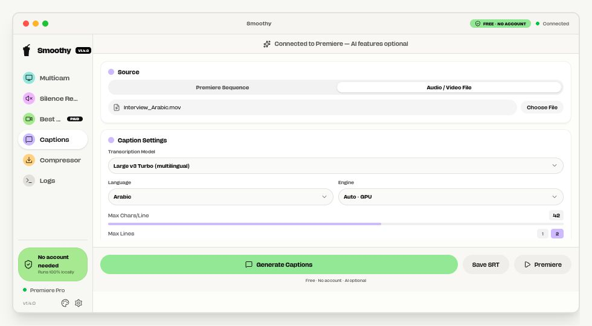
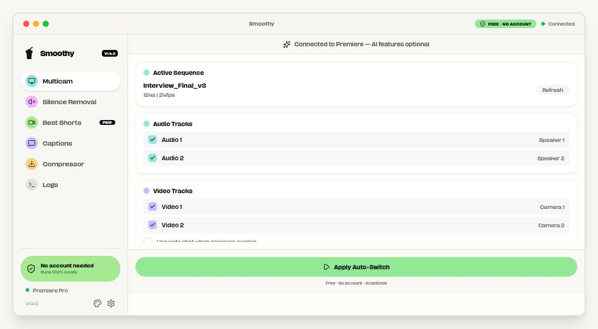

# SmoothyEdit

**Free local editing tools for Premiere Pro and DaVinci Resolve Free.** Switch multicam angles, cut silence, generate and edit multilingual captions, import SVGs and images, and compress video from one desktop app. The Premiere panel connects your timeline to SmoothyEdit; the core tools run on your computer.

[Download for Mac](https://smoothyedit.com/api/download/mac) · [Download for Windows](https://smoothyedit.com/api/download/win) · [See the latest release](https://github.com/alibahrawy/smoothyapp/releases/latest) · [Visit the website](https://smoothyedit.com/features/smoothy-app)

> **2.1 release:** macOS **2.1.0** for Apple Silicon is signed and notarized. Windows downloads remain **2.0.0** until a Windows 2.1 build is published. Linux AppImage and .deb packages are built on native x64 and arm64 runners.

## A look inside

These interface mockups show the SmoothyEdit 1.4 layout.

| Multilingual captions | Multicam editing |
| --- | --- |
|  |  |

## What it does

| Tool | Workflow |
| --- | --- |
| **Multicam (beta)** | Follow the active speaker on a duplicate of your source or nested timeline. The main camera stays on top, with the enabled reverse footage underneath for fine-tuning; clip effects and continuous audio are retained. |
| **Silence removal** | Detect quiet sections and remove them from the timeline with adjustable settings. |
| **Captions** | Transcribe an editor timeline or an audio/video file locally. Choose multilingual Whisper, specialist Moroccan Darija models or compatible custom GGML models; send captions to your editor or save an SRT. |
| **Audio Cleanup** | Split Speech and Music locally, enhance speech, listen with Solo/Mute and save WAVs. Automatic GPU selection falls back to CPU. |
| **Assets** | Convert SVGs and images to PNGs, preserve transparency, export files, or send a still to Premiere. |
| **Compressor** | Reduce video file size with hardware encoding when available. |
| **Stock Footage** | Search Commons, Internet Archive, NASA and the configured Pixabay service, preview shots, save MP4s and import into Premiere’s Project panel. |
| **Audio Library** | Preview an unofficial YouTube music archive, filter tracks, keep Favorites and Saved MP3s, and explore Staff picks. Verify each track’s license before publishing. |
| **Best Shorts** | Optional Studio feature that finds short-form moments and sends markers to Premiere. |

Premiere Pro connects through the bundled **CEP extension**. The desktop app installs or refreshes the panel when it starts. Premiere Pro 25.x and 26+ are supported. DaVinci Resolve Free connects through local Lua helpers. Start **Workspace → Scripts → Smoothy Connector** once per session; see the [setup guide](https://smoothyedit.com/blog/smoothy-connector-resolve-free). Generated timelines carry cuts, source timing and selected audio channels, but do not copy grades, effects, fades, automation or mixer processing. Review the imported edit.

## Install

1. Download the installer for your platform from the links above.
2. Install and open SmoothyEdit. The Premiere panel is installed or refreshed automatically.
3. Open Premiere Pro and the **SmoothyEdit Bridge** panel, then work from your active sequence. Captions can also start from a local audio or video file.

The local tools do not require an account. Studio cloud features are optional.

After updating, restart Premiere and reopen its SmoothyEdit panel, then refresh the sequence in SmoothyEdit. For Multicam, start from your original timeline and review both speakers and audio sync before using the duplicate. The dismissible update notice includes Discord and social support links.

Audio Library favorites stay local. Optional anonymous archive favorite sharing can be switched off in Licenses & credits; no local file names or audio are shared.

## Repository layout

| Path | Contents |
| --- | --- |
| [`smoothyapp/`](smoothyapp/) | Electron desktop app and build configuration |
| [`smoothyapp-cep/`](smoothyapp-cep/) | Premiere Pro CEP panel and ExtendScript bridge |
| [`docs/images/`](docs/images/) | 1.4 interface mockups used in this README |

## Development

```bash
cd smoothyapp
npm install
npm run dev
```

To make local installers on the matching platform:

```bash
cd smoothyapp
npm run build:mac  # macOS Apple Silicon DMG + ZIP update package; signing/notarization needs your own Apple credentials
npm run build:win  # Windows x64 installer
npm run build:linux  # Linux host only; native x64 or arm64 dependencies required
```

Build configuration is in [`smoothyapp/package.json`](smoothyapp/package.json). Published downloads and release notes are in [GitHub Releases](https://github.com/alibahrawy/smoothyapp/releases).

Stock footage source builds include Commons, Internet Archive and NASA without provider credentials. Pixabay requires your own compatible search service. Set `SMOOTHY_STOCK_SERVICE_URL` to its HTTPS endpoint when running `npm run build` or a platform build command. The service accepts `q`, `page` and `size` and returns video API metadata (`totalHits`, `hits`); keep your provider key on your server. Without a configured service, Pixabay is hidden. Provider keys and the official service configuration are not included in source builds.

A build can alternatively set `SMOOTHY_PIXABAY_API_KEY` to query the Pixabay API directly. The value is baked into that build only; put it in a gitignored `.env` or the environment, never in source. A configured service endpoint takes precedence over the key.

The desktop app is licensed under [MIT](smoothyapp/LICENSE).

## Open-source credits

Built with Electron, Whisper, FFmpeg, ONNX Runtime, PyTorch and many other projects. See the [open-source libraries, tools and models](docs/OPEN-SOURCE.md) and the [complete locked npm dependency inventory](docs/NPM-DEPENDENCIES.md). Thank you to their maintainers and contributors.
